# Звіт з лабораторної роботи №4

## Загальна інформація

- Студент — Дмитерчук Віталій Вадимович
- Група — ІПЗ-33
- Предметна область — електронна бібліотека
- Рівень виконання — 3
- [Репозиторій проєкту](https://github.com/Armovolt/databases-lab-01)

## Опис предметної області

Я розробив базу для бібліотеки, яка веде каталог, облік примірників та історію видач. Читач може знайти книгу. Бібліотекар додає й редагує видання, приймає повернення і створює бронювання. Адміністратор переглядає журнал змін.

## Концептуальна модель

Видання може мати кількох авторів і примірників. Бронювання стосується видання, а видача фіксує конкретний примірник. Для обліку цих операцій виділив сім основних сутностей.

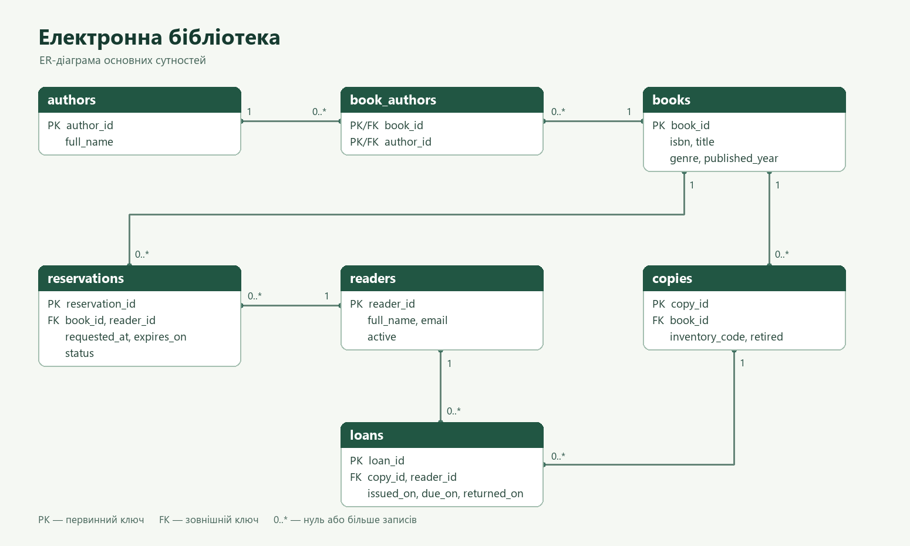

## Логічна схема

Між книгами й авторами зв’язок «багато до багатьох» через таблицю `book_authors`. Для зв’язків «один до багатьох» використав зовнішні ключі. Наприклад, `copies.book_id` посилається на видання, а `loans.copy_id` — на примірник. Дані про книгу й читача зберігаються у відповідних таблицях. Для видачі їх отримую за зовнішніми ключами. Така структура відповідає третій нормальній формі.

[Таблиці, ключі та обмеження](logical_schema.md)

## Реалізація в PostgreSQL

У [скрипті створення таблиць](../database/01_create_tables.sql) використав `PRIMARY KEY`, `FOREIGN KEY`, `NOT NULL`, `UNIQUE` та `CHECK`. Частковий унікальний індекс на `loans(copy_id)` дозволяє зберігати історію видач і блокує одночасну активну видачу одного примірника двом читачам.

Для завантаження схеми й даних запускається `python manage.py init`. Команда передає SQL-файли до `psql` в одній транзакції та припиняє імпорт, якщо виникає помилка. Для перевірки імпорту використав окрему порожню базу `library_lab04_import_check`. PostgreSQL створив таблиці, процедури, тригери й представлення та завантажив тестові записи.

Для бронювань додав [обмеження дат](../database/08_validate_reservation_dates.sql). PostgreSQL приймає дату завершення, що збігається з датою створення за UTC, і відхиляє дату, яка їй передує.

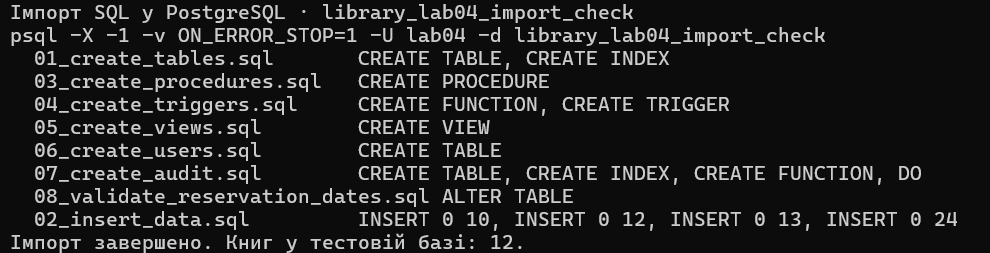

У робочій базі `library_lab04` перевірив рядки через `COUNT(*)`. Початковий набір містить 10 авторів, 12 видань, 13 зв’язків авторства, 24 примірники, 10 читачів, 12 видач і 10 бронювань. Також додав 10 вимкнених тестових облікових записів. Записи аудиту створюються тригерами під час завантаження.

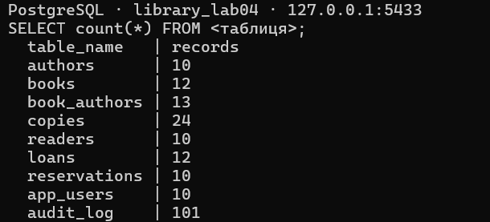

[Тестові дані](../database/02_insert_data.sql)

## Налаштування Docker

У `docker-compose.yml` використав `postgres:17-alpine`. Дані зберігаються у томі Docker. PostgreSQL доступний за адресою `127.0.0.1:5433` на комп’ютері, де запущено контейнер. Стан `healthy` перевіряється командою `pg_isready`.

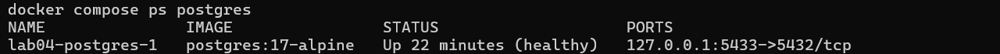

[Конфігурація Docker Compose](../docker-compose.yml)

## SQL-запити

### Рівень 1. Вибірки

| № | Запит | Результат |
|---|---|---|
| 1 | Видання прози з 1900 року | 3 видання |
| 2 | Пошук співавторів через JOIN | Іван Білик і Панас Мирний |
| 3 | Кількість видань за жанрами | 4 жанри, з них 6 видань прози |
| 4 | Видання без історії видач через NOT EXISTS | 6 видань |
| 5 | Активні видачі за найближчим строком повернення | Перші 5 записів |

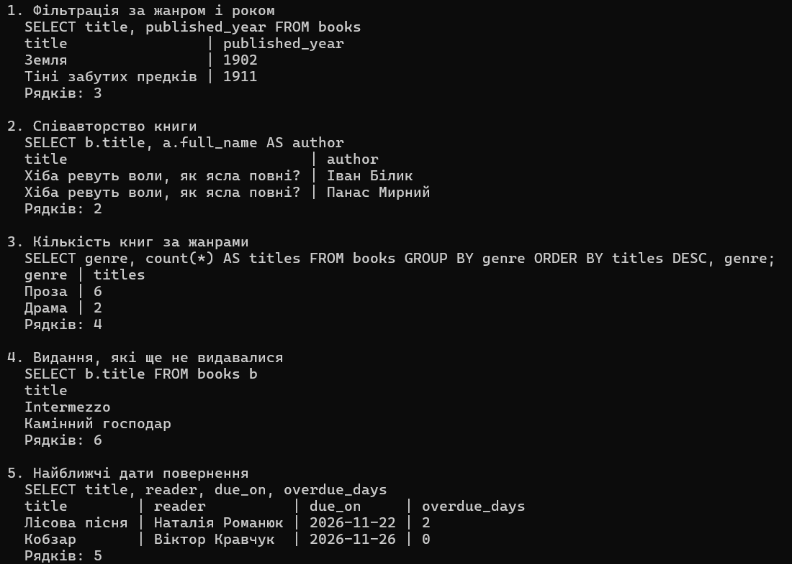

### Рівень 2. Аналітика

Я згрупував видачі за жанрами, знайшов читачів із двома або більше видачами та підрахував місячну статистику. У тестових даних зафіксовано 8 видач прози і 3 читачів із двома видачами. Місячний звіт окремо показує видачі, повернення та середню тривалість завершених видач. На кадрах показано до двох рядків кожного запиту та загальну кількість знайдених записів.

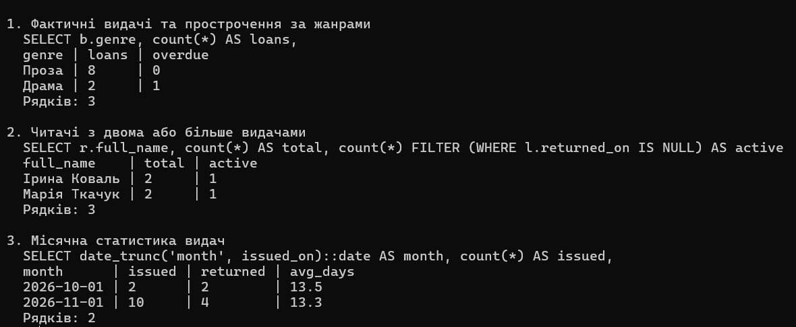

[Повний SQL усіх восьми запитів](../database/queries.sql)

### Рівень 2. Процедури, тригери та представлення

- `reserve_book` додає бронювання для активного читача.
- `issue_copy` оформлює видачу з урахуванням черги бронювань.
- `return_loan` фіксує повернення активної видачі.

Тригер `loans_validate_active` перевіряє стан читача та примірника й обмежує кількість активних видач. Тригер `copies_guard_retirement` блокує списання виданого примірника. У тесті обидві некоректні операції були відхилені. `v_catalog` показує наявність примірників, а `v_active_loans` — активні видачі та дні прострочення. Після повернення тестова видача зникла з представлення активних видач.

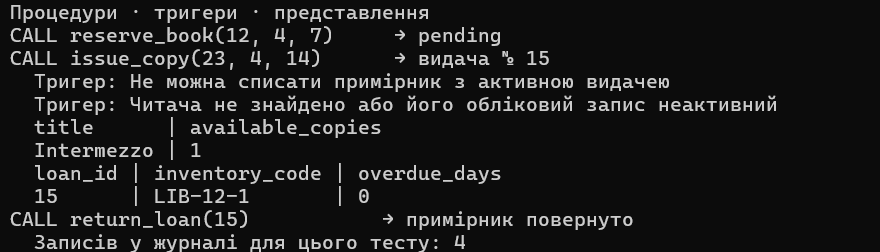

[Процедури](../database/03_create_procedures.sql) · [Тригери](../database/04_create_triggers.sql) · [Представлення](../database/05_create_views.sql)

## Консольний застосунок

Консольний застосунок працює з каталогом у PostgreSQL. Я перевірив повний цикл CRUD на тестовому виданні — додавання, читання, зміну назви й видалення. Після видалення пошук за ID підтвердив, що запису більше немає.

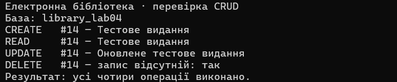

[Код консольного застосунку](../console_app/main.py)

## Вебзастосунок

У Flask створив каталог, сторінку видання, форми додавання й редагування та операцію видалення. Для видачі, повернення і бронювання використав окремі форми, підключені до збережених процедур. Під час перевірки CRUD додав тестову книгу, змінив її назву та видалив запис.

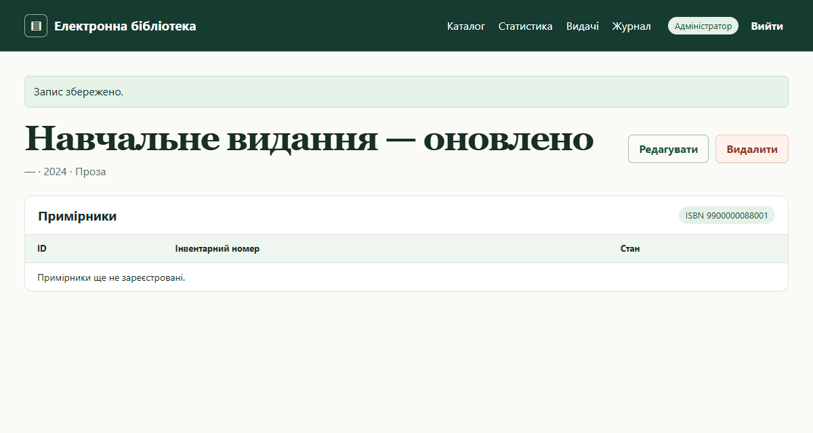

Сервер перевіряє ISBN, назву, жанр і рік видання. Для ISBN із трьох цифр він повернув повідомлення про помилку та код 422.

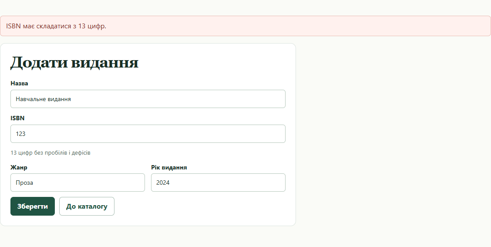

[Код вебзастосунку](../web_app/app.py)

## Розширена функціональність

### Реєстрація, вхід і ролі

Новий користувач отримує роль читача. Читач переглядає каталог, бібліотекар працює з книгами й видачами, а адміністратор має доступ до журналу. Перевірив створення облікового запису, вхід і вихід. При спробі відкрити форму додавання книги під роллю читача сервер повернув код 403.

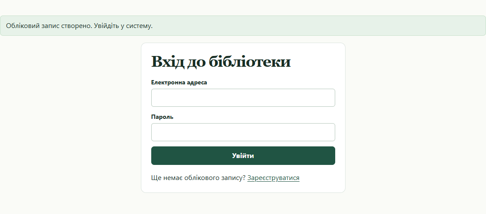

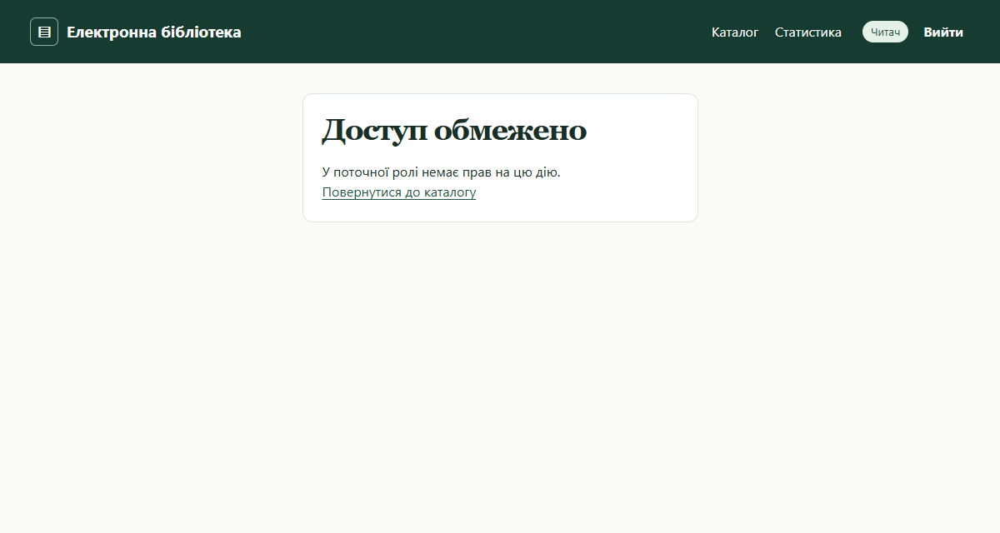

### Журнал змін і JavaScript-валідація

Аудит фіксує `INSERT`, `UPDATE` і `DELETE` у всіх таблицях із прикладними даними, зокрема для облікових записів. У журналі видно виконавця, час і тип операції. Значення до й після зміни зберігаються у JSONB.

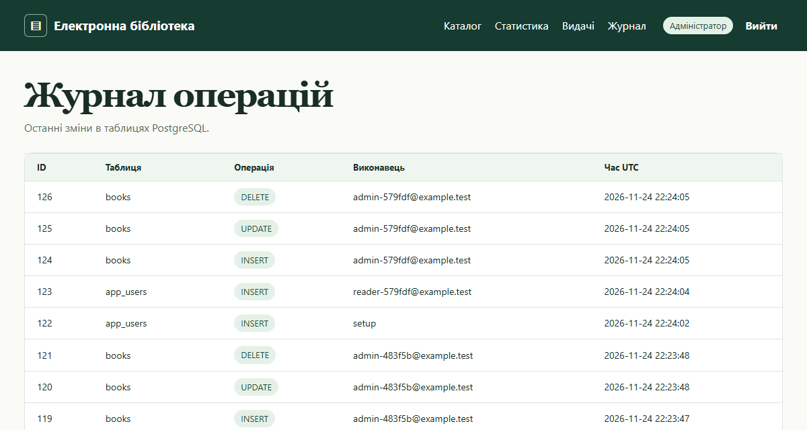

JavaScript перевіряє поля форми й показує помилку до відправлення запиту. Перевірив це на некоректному ISBN.

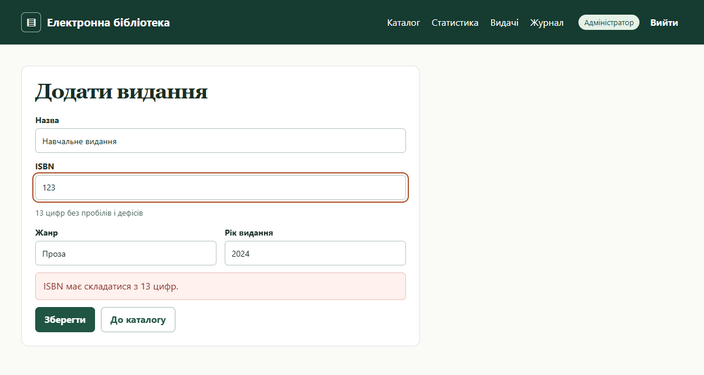

### Пошук, статистика та звіт

У каталозі можна шукати за назвою, автором або ISBN. Є фільтр за жанром і сортування за назвою, роком або доступністю. Пошук «Франко» з фільтром «Проза» повернув «Захар Беркут». На сторінці статистики показано загальну кількість видач і кількість прострочених активних видач за жанрами.

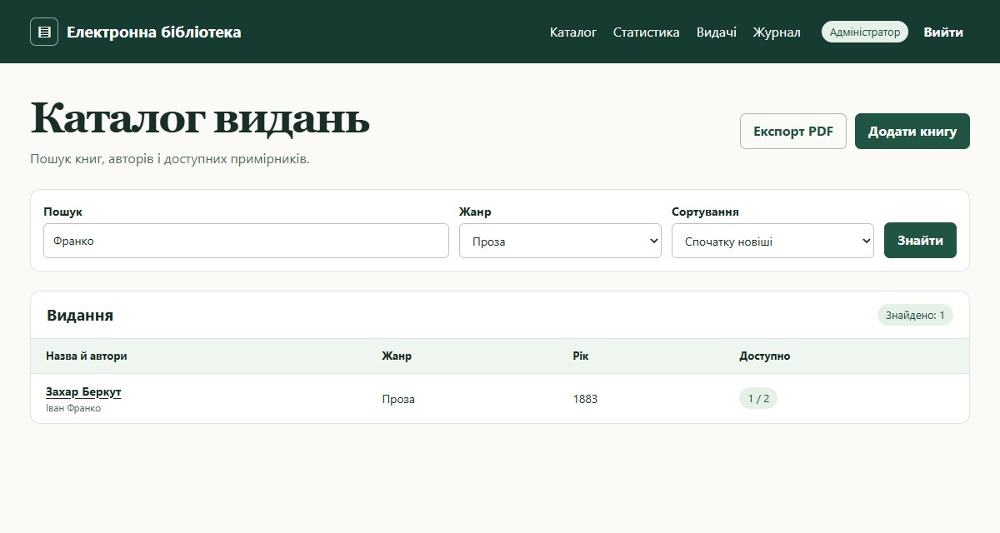

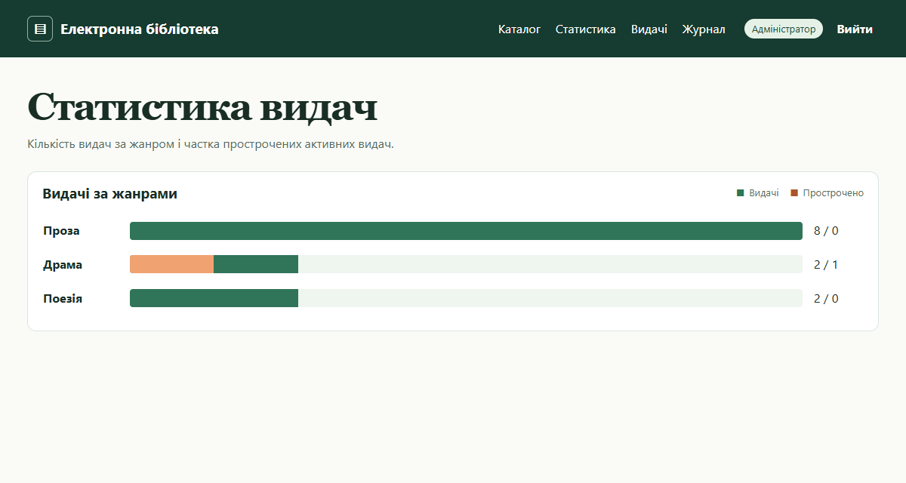

Кнопка «Експорт PDF» формує каталог із назвою, авторами, роком видання й кількістю доступних примірників. Перевірений PDF містив 12 видань.

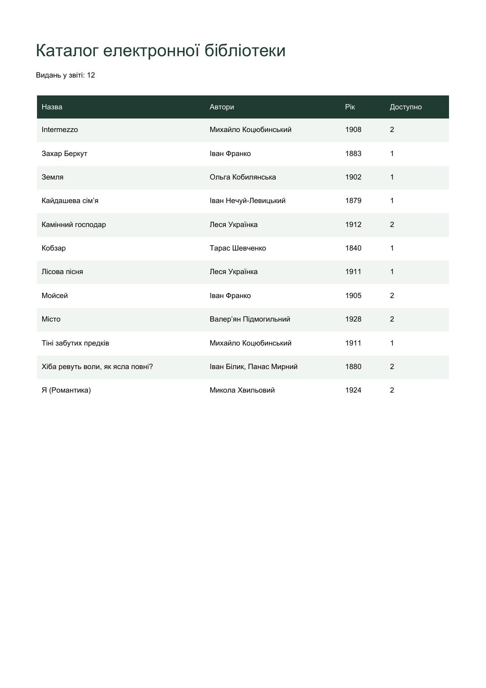

### API

Маршрут `GET /api/books` повертає каталог у JSON і підтримує параметри пошуку, жанру та сортування. `GET /api/books/<id>` повертає одне видання. Для відсутнього ID перевірено відповідь 404, а фільтр за жанром «Новела» повернув два видання.

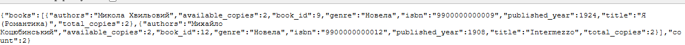

### Резервне копіювання

Команда `python manage.py backup` створює архів `pg_dump -Fc`. Перевірив його через `pg_restore --list`, після чого відновив дані в окремій контрольній базі. В архіві було дев’ять таблиць із даними, а в контрольній базі після відновлення — 12 книг.

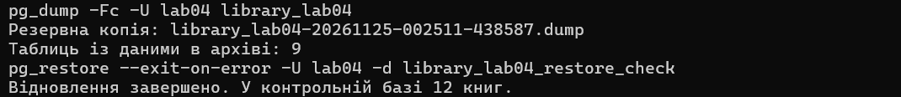

### Індекси

Додав складений індекс для фільтрації за жанром і роком, часткові індекси для активних видач і бронювань, а також індекси для пошуку за зовнішніми ключами. У `EXPLAIN (ANALYZE, BUFFERS)` перевірив `Index Scan` через `books_genre_year_idx`. Через невеликий тестовий набір на час перевірки використав `SET LOCAL enable_seqscan = off`, щоб показати, як індекс обслуговує запит.

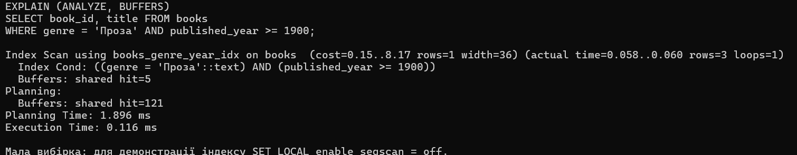

## Висновки

Під час лабораторної я спроєктував базу електронної бібліотеки й підключив до неї консольний та вебзастосунок. Найважливішим для мене було розділити видання і примірник, бо від цього залежить правильний облік видач. Я перевірив процедури й тригери на коректних і некоректних даних. Також перевірив права користувачів, формування PDF та відновлення даних із резервної копії.
