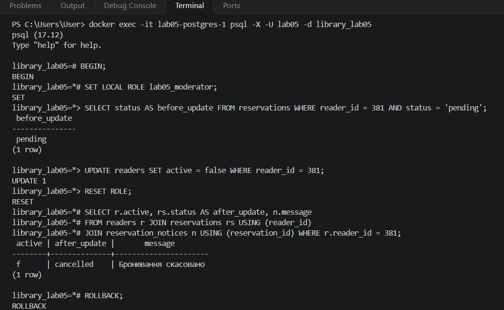

# Лабораторна робота №5

**Тема** — керування базою даних, оптимізація продуктивності та автоматизація  
**Студент** — Дмитерчук Віталій Вадимович  
**Група** — ІПЗ-33  
**Рівень виконання** — 3

## Підготовка середовища

Використав схему електронної бібліотеки з лабораторної №4. Створив окрему базу `library_lab05` у PostgreSQL 17 і додав згенеровані дані для вимірювань. У базі вийшло 40 010 читачів, 10 024 примірники, 202 412 видач і 50 010 бронювань. Після завантаження виконав `ANALYZE`, щоб PostgreSQL оновив статистику таблиць. [SQL наповнення](../sql/00_benchmark_data.sql) · [Кількість рядків](evidence/01-test-data.txt)

## Рівень 1

### Аналіз трьох запитів

Кожен запит виконав по три рази до і після створення нових індексів. Використав `EXPLAIN (ANALYZE, BUFFERS)` і порівняв медіани `Execution Time`. Відсоток показує, на скільки зменшився час виконання відносно початкового заміру. [SQL запитів](../sql/01_benchmark.sql) · [Плани до](evidence/02-plans-before.txt) · [Плани після](evidence/03-plans-after.txt)

| Запит | До, мс | Після, мс | Зменшення часу |
|---|---:|---:|---:|
| Історія видач читача | 16,972 | 0,335 | 98,0% |
| Видачі за тиждень за жанрами | 15,051 | 4,567 | 69,7% |
| Історія бронювань читача | 6,212 | 0,174 | 97,2% |

| Індекс | Для чого створив |
|---|---|
| `lab05_loans_reader_issued_idx` | Для пошуку видач за читачем і датою. У плані `Parallel Seq Scan` по видачах змінився на `Bitmap Index Scan` з вибіркою п’яти записів. |
| `lab05_loans_issued_idx` | Для вибірки видач за короткий проміжок часу перед групуванням за жанром. PostgreSQL використав `Bitmap Index Scan` для 1 911 видач замість паралельного сканування всієї таблиці. |
| `lab05_reservations_reader_requested_idx` | Для пошуку історії бронювань конкретного читача. `Index Scan` по `reader_id` повернув два записи замість перегляду всієї таблиці бронювань. |

[SQL створення трьох індексів](../sql/02_indexes.sql)

### Представлення, логування та доступ

Створив `v_lab05_reader_activity` для статистики видач кожного читача і `v_lab05_pending_queue` для черги чинних бронювань. Тригер `lab05_reader_update` записав у `audit_log` старе й нове ім’я після тестового оновлення читача. [SQL представлень і тригера](../sql/03_level1.sql) · [Результати перевірки](evidence/04-views-and-simple-audit.txt)

Під користувачем `lab05_viewer` отримав три книги з каталогу. Спроба виконати `UPDATE` завершилася помилкою `42501`. [Дозволене читання](evidence/05-viewer-read.txt) · [Відхилений запис](evidence/06-viewer-write-rejected.txt)

## Рівень 2

### Оновлюване представлення та аудит

Представлення `v_lab05_reader_contacts` об’єднує таблицю читачів зі статистикою видач. Правило `lab05_contact_update` спрямовує оновлення email до таблиці `readers`. Перевірив зміну адреси з `rule.before@example.test` на `rule.after@example.test`.

Тригер валідації відхилив вставку адреси `invalid-email` з кодом `23514`. Розширений аудит зафіксував окремі записи для вставки, зміни та видалення читача. У кожному записі є таблиця, тип дії, час і користувач. Для `UPDATE` у JSONB зберігаються обидва стани рядка. [SQL рівня 2](../sql/05_level2.sql) · [Перевірка правила й аудиту](evidence/09-rule-and-audit.txt) · [Перевірка валідації](evidence/10-invalid-email.txt)

### Часткові індекси

| Індекс | Які рядки містить | Результат перевірки |
|---|---|---|
| `lab05_loans_open_due_idx` | Активні видачі, у яких `returned_on IS NULL` | PostgreSQL використав новий індекс для пошуку 8 видач зі строком повернення на поточну дату. Час виконання змінився з 0,146 до 0,185 мс. |
| `lab05_reservations_pending_expiry_idx` | Бронювання зі статусом `pending` | PostgreSQL використав новий індекс для пошуку 6 бронювань із завершенням на поточну дату. Час виконання змінився з 0,268 до 0,114 мс. |

Дата перевірки використовується в запиті. Умови самих індексів ґрунтуються на значеннях рядка. У першому замірі PostgreSQL використав новий індекс і звернувся до меншої кількості сторінок, але час виконання трохи зріс. Другий запит використав менше сторінок і виконався швидше. Для цих коротких запитів порівняв також плани й буфери, бо один замір часу може коливатися. [SQL індексів](../sql/07_partial_indexes.sql) · [Плани до](evidence/07-partial-before.txt) · [Плани після](evidence/08-partial-after.txt)

### Резервне копіювання і відновлення

Створив архів через `pg_dump -Fc` і відновив його командою `pg_restore --exit-on-error` у базу `library_lab05_restore`. Після відновлення перевірив 12 книг, 202 412 видач, 50 010 бронювань, журнал змін та права переглядача. Сума видач у матеріалізованому представленні збіглася з кількістю рядків у таблиці `loans`. Ролі залишилися доступними, бо відновлення виконувалося в тому самому екземплярі PostgreSQL. [Команди й результат відновлення](evidence/13-backup-and-restore.txt)

## Рівень 3

### Матеріалізоване представлення та каскад тригерів

У `mv_lab05_daily_loans` зберігаю кількість виданих і повернених примірників за датою видачі. Після тестової вставки тригер автоматично оновив представлення, і лічильник повернень за цю дату зріс з 0 до 1.

Коли модератор деактивував читача, перший тригер змінив статус його незавершеного бронювання з `pending` на `cancelled`. Другий тригер записав сповіщення до `reservation_notices`. Обидві демонстрації провів у транзакціях із відкатом. [SQL рівня 3](../sql/09_level3.sql) · [Результати перевірки](evidence/11-level3.txt)



### Ієрархія ролей

| Роль | Каталог | Змінити email читача | Видалити книгу | Читати аудит | Запустити обслуговування |
|---|---|---|---|---|---|
| `lab05_user` | Так | Ні | Ні | Ні | Ні |
| `lab05_moderator` | Так | Так | Ні | Ні | Ні |
| `lab05_admin` | Так | Так | Так | Так | Так |

Модератор успадковує доступ звичайного користувача, а адміністратор — права модератора. Під роллю модератора змінив email через `RULE` і перевірив значення в таблиці. Адміністратор успішно запустив обслуговування, а користувач `lab05_viewer` отримав помилку доступу. [Матриця дозволів](evidence/11-level3.txt) · [Відхилений CALL](evidence/11b-maintenance-rejected.txt)

### Обслуговування та моніторинг

Процедура `lab05_maintain_database()` виконала `ANALYZE` і `REINDEX TABLE` для `loans` та `reservations`. У `maintenance_log` з’явилося по одному запису на таблицю. [Результат виклику процедури](evidence/11-level3.txt)

Скрипт моніторингу показав кількість сканувань і прочитаних записів для індексів цієї роботи, а через `pg_stat_statements` вивів 10 команд із найбільшим середнім часом виконання. Найдовше тривало масове завантаження видач. [SQL моніторингу](../sql/11_monitor.sql) · [Результат моніторингу](evidence/12-monitoring.txt)

## Висновки

Для всіх трьох запитів нові індекси зменшили час виконання на тестових даних. Найбільший виграш був у пошуку історії конкретного читача, бо PostgreSQL зміг одразу знайти невелику групу рядків. Часткові індекси допомогли вибирати активні записи за датою. Перед додаванням індексу варто перевірити план запиту, а після додавання — повторити заміри. Автоматичне повне оновлення матеріалізованого представлення зручне для цієї демонстрації, але зростання частоти запису збільшує витрати на оновлення.

## SQL представлень і тригерів

<details>
<summary>Рівень 1 · два представлення та початковий тригер</summary>

```sql
CREATE VIEW v_lab05_reader_activity AS
SELECT r.reader_id, r.full_name, count(l.loan_id) AS total_loans,
       count(l.loan_id) FILTER (WHERE l.returned_on IS NULL) AS open_loans,
       max(l.issued_on) AS last_loan
FROM readers r LEFT JOIN loans l USING (reader_id)
GROUP BY r.reader_id, r.full_name;

CREATE VIEW v_lab05_pending_queue AS
SELECT b.book_id, b.title, rs.reservation_id, rs.expires_on,
       row_number() OVER (
           PARTITION BY b.book_id ORDER BY rs.requested_at, rs.reservation_id
       ) AS queue_position
FROM books b JOIN reservations rs USING (book_id)
WHERE rs.status = 'pending'
  AND rs.expires_on >= (CURRENT_TIMESTAMP AT TIME ZONE 'UTC')::date;

CREATE TABLE audit_log (
    audit_id bigint GENERATED ALWAYS AS IDENTITY PRIMARY KEY,
    table_name text NOT NULL,
    operation text NOT NULL,
    record_id integer NOT NULL,
    changed_at timestamptz NOT NULL DEFAULT clock_timestamp(),
    changed_by name NOT NULL,
    old_values jsonb,
    new_values jsonb
);

CREATE FUNCTION lab05_log_reader_update() RETURNS trigger LANGUAGE plpgsql AS $$
BEGIN
    INSERT INTO audit_log (table_name, operation, record_id, changed_by, old_values, new_values)
    VALUES (TG_TABLE_NAME, TG_OP, NEW.reader_id, current_user, to_jsonb(OLD), to_jsonb(NEW));
    RETURN NEW;
END;
$$;

CREATE TRIGGER lab05_reader_update
AFTER UPDATE ON readers
FOR EACH ROW EXECUTE FUNCTION lab05_log_reader_update();
```

</details>

<details>
<summary>Рівень 2 · правило, валідація та аудит</summary>

```sql
CREATE VIEW v_lab05_reader_contacts AS
SELECT r.reader_id, r.full_name, r.email, r.active, a.total_loans
FROM readers r
JOIN v_lab05_reader_activity a USING (reader_id);

CREATE RULE lab05_contact_update AS
ON UPDATE TO v_lab05_reader_contacts DO INSTEAD
    UPDATE readers SET email = NEW.email
    WHERE reader_id = OLD.reader_id;

CREATE FUNCTION lab05_validate_email() RETURNS trigger LANGUAGE plpgsql AS $$
BEGIN
    IF NEW.email IS NULL OR NEW.email !~ '^[a-z0-9._%+-]+@[a-z0-9-]+(\.[a-z0-9-]+)*\.[a-z]{2,}$' THEN
        RAISE EXCEPTION USING
            ERRCODE = '23514', MESSAGE = 'Некоректна адреса електронної пошти';
    END IF;
    RETURN NEW;
END;
$$;

CREATE TRIGGER lab05_reader_validate_email
BEFORE INSERT OR UPDATE OF email ON readers
FOR EACH ROW EXECUTE FUNCTION lab05_validate_email();

DROP TRIGGER lab05_reader_update ON readers;
DROP FUNCTION lab05_log_reader_update();

CREATE FUNCTION lab05_audit_reader() RETURNS trigger LANGUAGE plpgsql
SECURITY DEFINER SET search_path = pg_catalog, pg_temp AS $$
DECLARE
    actor name := COALESCE(NULLIF(current_setting('role', true), 'none'), session_user::text);
BEGIN
    INSERT INTO public.audit_log (table_name, operation, record_id, changed_by, old_values, new_values)
    VALUES (TG_TABLE_NAME, TG_OP, COALESCE(NEW.reader_id, OLD.reader_id), actor,
            CASE WHEN TG_OP <> 'INSERT' THEN to_jsonb(OLD) END,
            CASE WHEN TG_OP <> 'DELETE' THEN to_jsonb(NEW) END);
    RETURN NULL;
END;
$$;

CREATE TRIGGER lab05_reader_audit
AFTER INSERT OR UPDATE OR DELETE ON readers
FOR EACH ROW EXECUTE FUNCTION lab05_audit_reader();

REVOKE EXECUTE ON FUNCTION lab05_audit_reader() FROM PUBLIC;
```

</details>

<details>
<summary>Рівень 3 · матеріалізоване представлення та каскад</summary>

```sql
CREATE MATERIALIZED VIEW mv_lab05_daily_loans AS
SELECT issued_on, count(*) AS loan_count,
       count(*) FILTER (WHERE returned_on IS NOT NULL) AS returned_count
FROM loans
GROUP BY issued_on;

CREATE UNIQUE INDEX lab05_daily_loans_day_idx ON mv_lab05_daily_loans (issued_on);

CREATE FUNCTION lab05_refresh_daily_loans() RETURNS trigger LANGUAGE plpgsql
SECURITY DEFINER SET search_path = pg_catalog, pg_temp AS $$
BEGIN
    REFRESH MATERIALIZED VIEW CONCURRENTLY public.mv_lab05_daily_loans;
    RETURN NULL;
END;
$$;

CREATE TRIGGER lab05_refresh_after_loan
AFTER INSERT OR UPDATE OR DELETE OR TRUNCATE ON loans
FOR EACH STATEMENT EXECUTE FUNCTION lab05_refresh_daily_loans();

CREATE TABLE reservation_notices (
    notice_id bigint GENERATED ALWAYS AS IDENTITY PRIMARY KEY,
    reservation_id integer NOT NULL REFERENCES reservations ON DELETE CASCADE,
    message text NOT NULL,
    created_at timestamptz NOT NULL DEFAULT clock_timestamp()
);

CREATE FUNCTION lab05_cancel_reader_reservations() RETURNS trigger LANGUAGE plpgsql
SECURITY DEFINER SET search_path = pg_catalog, pg_temp AS $$
BEGIN
    UPDATE public.reservations SET status = 'cancelled'
    WHERE reader_id = NEW.reader_id AND status = 'pending';
    RETURN NULL;
END;
$$;

CREATE TRIGGER lab05_reader_deactivated
AFTER UPDATE OF active ON readers FOR EACH ROW
WHEN (OLD.active AND NOT NEW.active)
EXECUTE FUNCTION lab05_cancel_reader_reservations();

CREATE FUNCTION lab05_log_reservation_cancellation() RETURNS trigger LANGUAGE plpgsql
SECURITY DEFINER SET search_path = pg_catalog, pg_temp AS $$
BEGIN
    INSERT INTO public.reservation_notices (reservation_id, message)
    VALUES (NEW.reservation_id, 'Бронювання скасовано');
    RETURN NULL;
END;
$$;

CREATE TRIGGER lab05_reservation_cancelled
AFTER UPDATE OF status ON reservations FOR EACH ROW
WHEN (OLD.status = 'pending' AND NEW.status = 'cancelled')
EXECUTE FUNCTION lab05_log_reservation_cancellation();

REVOKE EXECUTE ON FUNCTION lab05_refresh_daily_loans(), lab05_cancel_reader_reservations(),
    lab05_log_reservation_cancellation() FROM PUBLIC;
```

</details>
